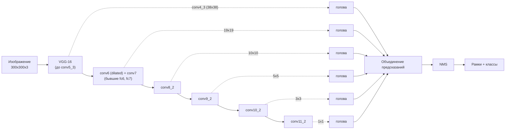

# SSD: Single Shot MultiBox Detector

> Liu W., Anguelov D., Erhan D., Szegedy C., Reed S., Fu C.-Y., Berg A. C. *SSD: Single Shot MultiBox Detector* // ECCV 2016. [arXiv:1512.02325](https://arxiv.org/abs/1512.02325)

## 1. Зачем нужен SSD

Двухстадийные детекторы (семейство R-CNN) сначала ищут гипотезы (region proposals), а потом классифицируют каждую из них. Это точно, но медленно: Faster R-CNN в статье SSD работает со скоростью около 7 FPS.

**SSD** (Single Shot MultiBox Detector) обходится **одним проходом** сверточной сети: рамки и классы предсказываются сразу, без отдельного этапа поиска гипотез и без повторной подвыборки признаков. Название расшифровывается так:

- **Single Shot** — один прямой проход сети;
- **MultiBox** — от метода MultiBox (Szegedy et al.), откуда взята идея регрессии рамок и сопоставления с эталоном.

Главные идеи метода:

1. предсказания делаются **с нескольких карт признаков разного разрешения** (мультимасштабность): ранние слои ловят мелкие объекты, глубокие — крупные;
2. на каждую позицию карты признаков кладётся набор **эталонных рамок** (default / anchor boxes) разных пропорций;
3. для каждой эталонной рамки сеть предсказывает **поправку к координатам** и **вероятности классов**;
4. предсказания всех слоёв объединяются, а дубликаты убираются с помощью **NMS**.

## 2. Архитектура

SSD состоит из двух частей: **базовой сети** (backbone) и **дополнительных сверточных слоёв**, к которым подключены «головы» предсказаний.



### 2.1. Базовая сеть

Берётся **VGG-16**, предобученная на ImageNet, без полносвязных слоёв. Изменения:

- слои `fc6` и `fc7` превращены в сверточные `conv6` (3x3, dilation = 6, то есть *atrous*-свёртка) и `conv7` (1x1);
- `pool5` заменён с 2x2/stride 2 на 3x3/stride 1, чтобы не терять разрешение;
- `conv4_3` имеет другой масштаб значений, чем остальные слои, поэтому к ней применяется **L2-нормализация** с обучаемым масштабом (идея из ParseNet).

### 2.2. Дополнительные слои

После `conv7` добавляются сверточные блоки (1x1 для сжатия каналов, затем 3x3 со stride 2), которые последовательно уменьшают карту признаков.

### 2.3. Карты признаков в SSD300

| Слой | Размер карты | Эталонных рамок на ячейку | Всего рамок |
|---|---|---|---|
| conv4_3 | 38 x 38 | 4 | 5776 |
| conv7 (fc7) | 19 x 19 | 6 | 2166 |
| conv8_2 | 10 x 10 | 6 | 600 |
| conv9_2 | 5 x 5 | 6 | 150 |
| conv10_2 | 3 x 3 | 4 | 36 |
| conv11_2 | 1 x 1 | 4 | 4 |
| **Итого** | | | **8732** |

Для SSD512 используется ещё один дополнительный слой, а общее число рамок больше.

### 2.4. Голова предсказаний

К каждой из выбранных карт признаков подключаются две параллельные свёртки **3x3**. Если на ячейку приходится $k$ эталонных рамок, а число классов (включая фон) равно $C$, то:

- классификационная свёртка выдаёт $k \cdot C$ каналов — оценки классов;
- регрессионная свёртка выдаёт $k \cdot 4$ канала — смещения рамки.

Таким образом, для карты $m \times n$ получается $(C + 4)\,k\,m\,n$ выходных значений.

## 3. Эталонные рамки (default boxes)

Каждой ячейке карты признаков сопоставляется набор рамок с центром в центре ячейки. Для $m$ карт признаков масштаб рамок на $k$-й карте:

$$
s_k = s_{min} + \frac{s_{max} - s_{min}}{m - 1}\,(k - 1), \quad k \in [1, m]
$$

где $s_{min} = 0.2$, $s_{max} = 0.9$ (доля от размера изображения). Для набора пропорций $a_r \in \{1, 2, 3, \tfrac12, \tfrac13\}$ ширина и высота рамки:

$$
w_k^{a} = s_k \sqrt{a_r}, \qquad h_k^{a} = \frac{s_k}{\sqrt{a_r}}
$$

Для $a_r = 1$ добавляется ещё одна рамка масштаба $s'_k = \sqrt{s_k s_{k+1}}$. Отсюда 6 рамок на ячейку; на слоях с «4 рамками» пропорции 3 и 1/3 не используются.

**Идея:** рамки на мелких картах (глубокие слои) крупные, на крупных картах (ранние слои) — мелкие. Так сеть покрывает объекты разных размеров, не пересчитывая изображение в пирамиду.

## 4. Обучение

### 4.1. Сопоставление предсказаний с эталоном (matching)

Каждая эталонная рамка сопоставляется с размеченной (ground truth), если их **IoU > 0.5**. Дополнительно для каждой GT-рамки всегда выбирается эталонная рамка с максимальным IoU, чтобы ни один объект не остался без положительного примера. Остальные рамки считаются фоном.

Такое правило допускает, что одной GT-рамке соответствует сразу несколько эталонных, — это упрощает обучение.

### 4.2. Функция потерь

$$
L(x, c, l, g) = \frac{1}{N}\Big(L_{conf}(x, c) + \alpha\, L_{loc}(x, l, g)\Big), \qquad \alpha = 1
$$

где $N$ — число сопоставленных эталонных рамок (если $N = 0$, потеря равна 0).

**Локализация** — Smooth L1 по закодированным смещениям $(cx, cy, w, h)$ относительно эталонной рамки $d$:

$$
L_{loc} = \sum_{i \in Pos} \sum_{m \in \{cx, cy, w, h\}} \mathrm{smooth}_{L1}\big(l_i^m - \hat g_j^m\big)
$$

$$
\hat g^{cx} = \frac{g^{cx} - d^{cx}}{d^{w}}, \quad
\hat g^{cy} = \frac{g^{cy} - d^{cy}}{d^{h}}, \quad
\hat g^{w} = \log\frac{g^{w}}{d^{w}}, \quad
\hat g^{h} = \log\frac{g^{h}}{d^{h}}
$$

**Классификация** — softmax cross-entropy по всем классам, включая фон:

$$
L_{conf} = -\sum_{i \in Pos} x_{ij}^{p} \log \hat c_i^{p} \;-\; \sum_{i \in Neg} \log \hat c_i^{0}
$$

### 4.3. Hard negative mining

Фоновых рамок на порядки больше, чем объектов, и они дали бы перекос в обучении. Поэтому отрицательные примеры сортируются по величине потери классификации, и берутся только **худшие** так, чтобы соотношение отрицательных к положительным было **3 : 1**.

### 4.4. Аугментации

В статье отмечено, что аугментации критичны для SSD (особенно для мелких объектов), давая прирост порядка нескольких пунктов mAP:

- фотометрические искажения (яркость, контраст, насыщенность);
- **expand** — вставка изображения на большее полотно (эффект «отдаления»);
- **random crop** — случайные кропы с ограничением на минимальный IoU с объектами;
- горизонтальное отражение.

## 5. Вывод (inference)

1. Один прямой проход даёт предсказания для всех $\approx$ 8732 рамок (SSD300).
2. Отбрасываются рамки с уверенностью ниже порога (например, 0.01–0.5).
3. Применяется **NMS** (non-maximum suppression) отдельно для каждого класса, оставляется не более $N$ лучших рамок (в статье — 200 на изображение).

## 6. Результаты и сравнение

Данные из статьи (Pascal VOC2007 test, обучение на VOC07+12):

| Метод | mAP, % | FPS (batch 1) | FPS (batch 8) | Стадий |
|---|---|---|---|---|
| Faster R-CNN (VGG-16) | 73.2 | 7 | — | 2 |
| YOLO (v1) | 63.4 | 45 | — | 1 |
| **SSD300** | **74.3** | 46 | **59** | 1 |
| **SSD512** | **76.8** | 19 | 22 | 1 |

SSD300 одновременно быстрее Faster R-CNN и точнее его. FPS приведены для GPU того времени (NVIDIA Titan X), поэтому на современном железе числа другие, но соотношение сохраняется.

> **Почему на исходной страничке другие числа (72.1 % и 75.1 %, вход 500×500).** Они взяты из первой версии препринта на arXiv (декабрь 2015). В итоговой версии статьи (ECCV 2016) обучение было доработано, вход 500×500 заменён на 512×512, и авторы приводят 74.3 % (SSD300) и 76.8 % (SSD512). Ссылаясь на результаты, лучше указывать, из какой версии статьи они взяты.

**Сильные стороны:**

- простота и скорость (единая сеть, обучение end-to-end);
- хорошая работа с объектами разных размеров за счёт мультимасштабности.

**Слабые стороны:**

- мелкие объекты обнаруживаются хуже: они определяются по ранним картам, в которых мало семантики (позднее эту проблему адресовали FPN и RetinaNet);
- сильная зависимость от аугментаций и настройки эталонных рамок под набор данных;
- сильный дисбаланс фон/объект решается эвристикой (hard negative mining); в RetinaNet для этого предложили Focal Loss.

## 7. Как запустить

### 7.1. torchvision (SSD300 + VGG-16, веса COCO)

```python
import torch
from PIL import Image
from torchvision.models.detection import ssd300_vgg16, SSD300_VGG16_Weights
from torchvision.utils import draw_bounding_boxes
from torchvision.transforms.functional import pil_to_tensor
import matplotlib.pyplot as plt

weights = SSD300_VGG16_Weights.COCO_V1
model = ssd300_vgg16(weights=weights, score_thresh=0.4).eval()
preprocess = weights.transforms()
categories = weights.meta["categories"]

img = pil_to_tensor(Image.open("recog_2/1.jpg").convert("RGB"))
with torch.no_grad():
    pred = model([preprocess(img)])[0]

labels = [f"{categories[i]}: {s:.2f}" for i, s in zip(pred["labels"], pred["scores"])]
vis = draw_bounding_boxes(img, pred["boxes"].round().int(), labels, colors="red", width=3)
plt.imshow(vis.permute(1, 2, 0)); plt.axis("off"); plt.show()
```

> Предобученные веса скачиваются при первом запуске. Рамки возвращаются в координатах исходного изображения (`transforms()` в torchvision масштабирует вход, а модель пересчитывает выход обратно).

### 7.2. Другие реализации

- Оригинальный код на Caffe: [weiliu89/caffe (ветка ssd)](https://github.com/weiliu89/caffe/tree/ssd)
- PyTorch: [amdegroot/ssd.pytorch](https://github.com/amdegroot/ssd.pytorch)
- TensorFlow Hub / Model Garden: готовые SSD с MobileNet (SSD-MobileNet популярна на мобильных устройствах)

## 8. Эволюция: что идёт дальше

| Модель | Что улучшено относительно SSD |
|---|---|
| DSSD | deconvolution-слои и skip-связи — больше контекста для мелких объектов |
| RefineDet | двухшаговое уточнение рамок (anchor refinement) внутри одностадийной сети |
| RetinaNet | FPN + Focal Loss вместо hard negative mining |
| SSDLite | облегчённая голова на depthwise-свёртках для мобильных устройств |

## 9. Контрольные вопросы

1. Чем SSD отличается от Faster R-CNN? Почему он быстрее?
2. Сколько эталонных рамок в SSD300 и откуда берётся число 8732?
3. Для чего нужен hard negative mining и почему соотношение 3 : 1?
4. Почему мелкие объекты SSD находит хуже крупных?
5. Как кодируются смещения рамки относительно эталонной?

## 10. Источники

1. Liu W. et al. *SSD: Single Shot MultiBox Detector*, ECCV 2016 — <https://arxiv.org/abs/1512.02325>
2. Szegedy C. et al. *Scalable High Quality Object Detection* (MultiBox) — <https://arxiv.org/abs/1412.1441>
3. Liu W. et al. *ParseNet: Looking Wider to See Better* (L2-нормализация) — <https://arxiv.org/abs/1506.04579>
4. Fu C.-Y. et al. *DSSD: Deconvolutional Single Shot Detector* — <https://arxiv.org/abs/1701.06659>
5. Lin T.-Y. et al. *Focal Loss for Dense Object Detection* (RetinaNet) — <https://arxiv.org/abs/1708.02002>
6. Документация torchvision: `torchvision.models.detection.ssd300_vgg16`
